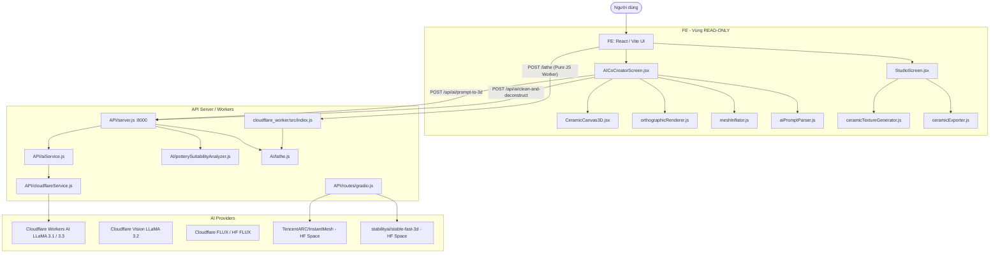

# BÁO CÁO AUDIT KIẾN TRÚC THUẬT TOÁN 3D VÀ PIPELINE GỐM VIỆT (PRJ_CERAMIC_AI)
**Tác giả:** Senior 3D Algorithm Engineer · Computer Vision · Backend Optimization  
**Ngày thực hiện:** 14/10/2026  
**Nhánh làm việc:** `khoaduc` (Commit Baseline: `d525bf3dea95cd2aa015d919fc8082d4cadf1433`)  
**Tình trạng bảo vệ:** `main` hoàn toàn nguyên vẹn; `FE/` hoàn toàn READ-ONLY.

---

## 1. TỔNG QUAN HỆ THỐNG VÀ ĐỒ THỊ PHỤ THUỘC (DEPENDENCY GRAPH)

---

## 2. PHÂN TÍCH CHI TIẾT TỪNG LUỒNG XỬ LÝ 3D (ACTIVE VS DEAD/FALLBACK PATHS)

### Luồng A: Text Prompt → Shape Parameters → LathePoints → Three.js
- **Trạng thái:** **ACTIVE PRODUCTION PATH**.
- **Được FE gọi:** Có, trong `AICoCreatorScreen.jsx` (`handleGenerateFromPrompt` gọi `handleGenerateAIFallback`).
- **Endpoint:** `POST /api/ai/prompt-to-3d` (`API/server.js:178`).
- **Xử lý:**
  - `aiService.promptTo3DConcept` → `cloudflareService.promptTo3DConcept`.
  - Nếu có Cloudflare API key: Gọi LLaMA sinh JSON `{ archetype, shapeParams, suggestedGlaze, pattern, ... }`.
  - Nếu timeout/lỗi/không key: Chạy rule-engine fallback (`fallbackPromptToConcept`).
  - FE nhận `shapeParams` → gọi `paramsToLathePoints(concept.shapeParams)` (Catmull-Rom spline) → Three.js `LatheGeometry`.
- **Đánh giá:** Rất ổn định, độc lập với GPU/HuggingFace.

### Luồng B: Upload ảnh/tiêu bản → Phân tích & Trích xuất 6 mặt trực giao + Lathe
- **Trạng thái:** **ACTIVE PRODUCTION PATH**.
- **Được FE gọi:** Có, trong `AICoCreatorScreen.jsx` và các màn hình phôi.
- **Endpoint:** `POST /api/ai/clean-and-deconstruct` (`API/server.js:264`).
- **Xử lý:**
  - `cleanAndRemoveText` (Sharp + `@imgly/background-removal-node` nếu có): Tách nền, loại nhiễu.
  - Chuẩn hóa canvas Studio 750×750 `#F8F7F4`.
  - `maskAndBbox`: Lấy mask và hộp bao vật thể.
  - Quét 60 scanlines từ `maxY` đến `minY` → tính bán kính `r` và cao độ `y`.
  - Bộ lọc: Median filter 5 → Gaussian smooth 5 → Douglas-Peucker 0.012 → Catmull-Rom resampling (18 điểm).
  - Cắt `maxRIdx` cho bát/đĩa tránh vòng lồi do elip miệng ảnh 2D xiên.
  - Chuẩn hóa Y về target space theo `modelType` ('bowl', 'plate', 'mug', 'vase').
  - Thêm vành miệng (rim) và thành trong (inner wall) xuống đáy trong.
  - Dựng 6 ảnh trực giao chuẩn 750×750: Front, Back, Left, Right, Top, Bottom.
  - Đánh giá khả năng nặn: `analyzePotterySuitability(cleanedBuffer, { modelType, lathePoints })`.
- **Đánh giá:** Đây là thuật toán 3D trung tâm của hệ thống backend. Cần bảo toàn và đồng bộ với isomorphic `AI/lathe.js`.

### Luồng C: Cloudflare Worker `/lathe` (Pure JS Isomorphic Image-to-3D)
- **Trạng thái:** **ACTIVE PRODUCTION / CLOUD PATH**.
- **Được FE gọi:** Dành cho Cloudflare Pages triển khai không có Express Node.js.
- **Endpoint:** `POST /lathe` (`cloudflare_worker/src/index.js:89`).
- **Xử lý:**
  - Nhận `{ imageBase64, modelType, mugPoints, maskBase64 }`.
  - Decode ảnh PNG/JPEG bằng `pngjs` và `jpeg-js` (pure JS, không native sharp).
  - Gọi `imageToLathePoints` trong `AI/lathe.js`.
  - Trả về `{ lathePoints, modelType, outerCurve, objectCount, areaRatio, empty }`.
- **Đánh giá:** Có 2 lỗi P0 nghiêm trọng được phát hiện (bỏ qua `maskBase64` và lỗi không bắt được ảnh rỗng).

### Luồng D: AI Image-to-3D Mesh qua Hugging Face (InstantMesh / Stable Fast 3D)
- **Trạng thái:** **FALLBACK / OPTIONAL PATH (Bị vô hiệu hóa mặc định trên FE)**.
- **Được FE gọi:** FE đã chuyển sang mô hình Parametric Spline/Lathe vì Hugging Face ZeroGPU liên tục cạn quota (ghi chú trực tiếp tại `AICoCreatorScreen.jsx:17, 213`).
- **Endpoint:** `POST /api/ai/gradio/image-to-3d` (`API/routes/gradio.js:310`).
- **Phụ thuộc:** HF Token, kết nối internet, ZeroGPU quota.
- **Bảo mật:** Phát hiện nguy cơ SSRF trong việc fetch ảnh và cache GLB.

### Luồng E: Client-side Silhouette Mesh Inflation (`FE/src/utils/meshInflator.js`)
- **Trạng thái:** **ACTIVE CLIENT PATH (100% Client-side JS)**.
- **Xử lý:** Euclidean Distance Transform O(N) (Felzenszwalb & Huttenlocher) tạo mesh lồi trực tiếp trên Canvas.

---

## 3. DANH SÁCH LỖI VÀ VẤN ĐỀ KIẾN TRÚC PHÁT HIỆN CÓ BẰNG CHỨNG

| Mã lỗi | Mức độ | File / Hàm | Bằng chứng mã nguồn | Tác động |
|---|---|---|---|---|
| **BUG-01** | **P0 (Critical)** | `AI/lathe.js` `maskAndBbox()` | Dòng 148–164: Hàm trả về `{ mask, minX, maxX, minY, maxY, cx, objW, objH }` **không hề có thuộc tính `empty`**. Với ảnh hoàn toàn rỗng, `minX=pw`, `maxX=0` (bbox đảo chiều), nhưng `bbox.empty` là `undefined` (falsy), dẫn đến `imageToLathePoints()` chạy tiếp và sinh ra mô hình thanh trụ giả cho ảnh rỗng. | Sinh mô hình 3D rác khi người dùng tải ảnh trắng/rỗng; vi phạm tính đúng đắn hình học. |
| **BUG-02** | **P0 (Critical)** | `cloudflare_worker/src/index.js` `POST /lathe` | Dòng 96–110: `imageToLathePoints` được gọi trước `body.maskBase64`. Khi có `maskBase64`, worker giải mã mask rồi chỉ gán `result = { ...result, objectCount: 0 }`, **hoàn toàn bỏ qua mask đã decode**, không dựng lại profile từ mask và gán cứng `objectCount = 0`. | Tính năng truyền mask từ FE segmentation bị vô hiệu hóa ngầm trên Worker; `objectCount` sai sự thật. |
| **BUG-03** | **P0 (Critical)** | `AI/potterySuitabilityAnalyzer.js` `_connectedComponentAreas()` | Dòng 126: `if (nx < 0 \|\| ny < 0 \|\| nx >= w \|\| ny >= w) continue;`. Viết nhầm `ny >= w` thay vì `ny >= h`. | Với ảnh không vuông (`w != h`), khi `w > h`, `ny` vượt quá chiều cao ảnh gây truy cập mảng tràn biên `mask[ny * w + nx]`, có thể crash hoặc phân loại sai số đối tượng. |
| **BUG-04** | **P1 (High)** | `AI/lathe.js` vs `API/server.js` | `API/server.js` (537–636) có Median Filter 5, Gaussian Smooth, Catmull-Rom interpolation (18 pts) cho đường cong mượt; trong khi `AI/lathe.js` chỉ có Douglas-Peucker thô sơ, không có Median/Gaussian, dẫn đến Worker tạo profile gãy khúc và răng cưa khi gặp ảnh có họa tiết. | Chất lượng 3D giữa Node server và Cloudflare Worker không đồng nhất. |
| **BUG-05** | **P1 (High)** | `API/server.js` `clean-and-deconstruct` | Dòng 311: `path.resolve('/tmp/sketch_...')`. Trên môi trường Windows, đường dẫn này resolve thành `C:\tmp\...`, dễ gặp lỗi không tồn tại thư mục hoặc không có quyền ghi. | Crash API khi xử lý upload base64 trên Windows server. |
| **BUG-06** | **P1 (High)** | `API/cloudflareService.js` `sanitizeConcept()` | Dòng 468: `shapeParams` nhận từ LLM không được validate kiểu dữ liệu từng trường con (`height`, `maxRadius`, `neckRatio`, `rimFlare`, `baseRadius`). Nếu LLM trả chuỗi hoặc số âm/NaN, FE `paramsToLathePoints` sẽ tạo các tọa độ NaN. | Tọa độ NaN trong geometry làm hỏng Three.js renderer. |
| **BUG-07** | **P1 (High)** | `API/routes/gradio.js` `downloadAndCacheGlb()` | Dòng 193: Gọi `fetchBuffer(remoteGlb)` với bất kỳ URL nào được gửi lên mà không kiểm tra URL scheme (HTTP/HTTPS) hoặc chặn loopback/private IPs (SSRF). | Nguy cơ bảo mật SSRF đối với server nội bộ. |
| **BUG-08** | **P1 (High)** | Root `.gitignore` | Chưa có cấu hình loại trừ `node_modules/` ở root. | Khi chạy test/build có thể làm ô nhiễm git status nếu không kiểm soát chặt. |

---

## 4. CHIẾN LƯỢC SỬA LỖI VÀ TỐI ƯU (ACTION PLAN)
1. **P0 Fixes:**
   - Hoàn thiện `maskAndBbox` trong `AI/lathe.js`: Kiểm tra `area === 0` hoặc `maxX < minX`, trả về `empty: true`, chuẩn hóa `minX=0, maxX=0, minY=0, maxY=0, cx=0, objW=0, objH=0`.
   - Fix Worker `/lathe`: Khi có `maskBase64`, resize/align mask phù hợp, sinh profile trực tiếp từ mask đó, tính `objectCount` và `areaRatio` thực tế.
   - Fix `ny >= h` trong `_connectedComponentAreas` (`AI/potterySuitabilityAnalyzer.js`).
2. **P1 Improvements:**
   - Đồng bộ bộ lọc làm mượt (Median Filter + Moving Average + Catmull-Rom resample) vào `AI/lathe.js`.
   - Dùng `os.tmpdir()` cho file tạm trong `API/server.js`.
   - Thêm strict schema validator và bounding limiter cho `shapeParams` trong `API/cloudflareService.js`.
   - Thêm URL validation và SSRF prevention cho `fetchBuffer` trong `API/lib/gradioClient.js`.
   - Cập nhật `.gitignore` ngăn ngừa commit `node_modules/`.
3. **Hiệu năng:**
   - Tối ưu hóa mảng TypedArray (`Uint8Array`, `Float64Array`) trong `silhouetteToLathePoints` và `buildObjectMask`.
   - Đo benchmark thời gian thực thi (median, P95, RAM) trước và sau tối ưu.
4. **Kiểm thử:**
   - Xây dựng bộ test suite tự động gồm: Group A (Dáng chuẩn), Group B (Ảnh khó), Group C (Edge cases/Empty), Group D (API Contract), Group E (Geometry Bounds & Manifoldness).
